<picture>
  <source media="(prefers-color-scheme: dark)" srcset="./assets/header-dark.svg">
  <source media="(prefers-color-scheme: light)" srcset="./assets/header-light.svg">
  
</picture>

I'm a third-year student at the Faculty of Computer Science, "Alexandru Ioan Cuza" University in Iasi. Most of my code is Python, and lately most of it touches machine learning: transformer classifiers, LLMs wired into web apps, and the experiment tracking and CI around a model once it leaves the notebook.

I pick projects that make me learn something I don't know yet, and I look for the simplest solution that does the job properly. I'm looking for a place on a team where I can keep doing that, ideally one that builds things with ML.

<br>

### `$ ls ~/projects`

**[AI_Detection](https://github.com/Squirrrell/AI_Detection)** estimates how likely a text is to be machine-written. It combines four signals instead of trusting one classifier, and shows a confidence label based on how much they agree. Next.js on the front, FastAPI behind it.

```text
text ─┬──► roberta × 2 (fakespot, openai) ──┐
      ├──► binoculars (observer/performer) ─┤
      ├──► burstiness ──────────────────────┼──► likelihood score + confidence
      └──► humanizer pattern checks ────────┘
```

**[europa-desk](https://github.com/Squirrrell/europa-desk)** is a map of Europe where you hover a country to see its top stories. An LLM merges duplicate headlines, rewrites them neutrally and ranks them for 45 countries. Without an API key it falls back to a keyword heuristic.

```text
google news rss ──► scraper ──► clustering ──► llm ranking ──► snapshot.json ──► map
```

**[Rezumat_PDF](https://github.com/Squirrrell/Rezumat_PDF)** summarizes research papers and answers questions about them offline, using small Hugging Face models that fit on a laptop GPU.

```text
pdf ──► marker ──► chunks ──► faiss + small hf models ──► summaries, q&a, test cards
```

**[MLOps-practice](https://github.com/Squirrrell/MLOps-practice)** is a deliberately boring model (Titanic survival) used to learn the pipeline around it: tracked experiments and an accuracy gate meant for CI.

```text
titanic.csv ──► prepare.py ──► train.py ──► mlflow ──► evaluate.py (fails below 0.75)
```

<details>
<summary>more</summary>
<br>

| | |
|---|---|
| MemoVox | Android voice notes app written in Python, built around voice detection. An iOS version is planned. |
| Portfolio rebuild | Rebuilt the UI and UX of a digital portfolio, working on Core Web Vitals, mobile layout and SEO. |
| [Neural_Networks](https://github.com/Squirrrell/Neural_Networks) | Coursework on an extended MNIST dataset. |
| [android_entropy](https://github.com/Squirrrell/android_entropy) | Small Kotlin app that computes binary entropy. |
| [Topdown_Roguelike](https://github.com/Squirrrell/Topdown_Roguelike) | A top-down roguelike in C#. |

</details>

<br>

### `$ cat stack.toml`

```toml
[code]
daily = ["python"]
also  = ["typescript", "c++", "kotlin", "c#", "java", "html"]

[ml]
models    = ["pytorch", "transformers", "sentence-transformers"]
retrieval = ["faiss"]
classical = ["scikit-learn", "pandas", "numpy"]
tracking  = ["mlflow"]

[apps]
backend  = ["fastapi"]
frontend = ["next.js"]
ops      = ["docker", "git", "ci/cd"]

[spoken]
romanian = "native"
english  = "C1"
german   = "A2"
```
